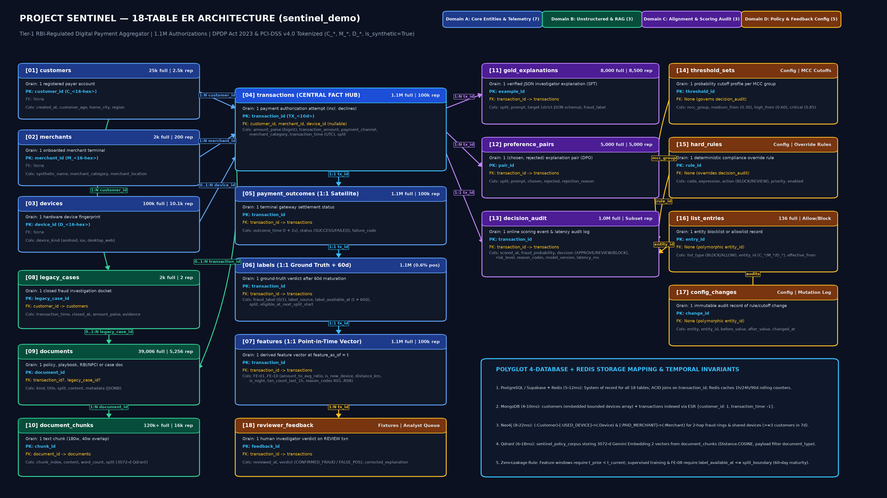
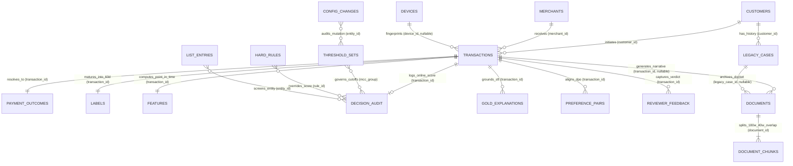

# Project SENTINEL — Polyglot Data Architecture & Point-in-Time Feature Engineering Engine

Production data architecture, 18-table relational and unstructured schema specification, 60-day chargeback maturation leakage guardrails, point-in-time feature derivation (`FE-01` to `FE-10` and `R01` to `R08`), and polyglot persistence verification suite for a **Tier-1 RBI-Regulated Digital Payment Aggregator** (UPI / Card / Wallet / Net-Banking).

---

## 1. Engineering Challenge & System Context

### 1.1 Payment Gateway Scale & Channel Distribution
The platform processes real-time payment authorizations across **1,80,000+ onboarded merchants** and **~90 million unique payer accounts** across India.

| Operational Metric | Current Production Baseline | 18-Month Target Horizon | Architectural Impact |
| :--- | :--- | :--- | :--- |
| **Daily Authorization Volume** | **4.2 million** txns / day | **8.0 million** txns / day | High-velocity append stream; requires partitioned relational + NoSQL document storage |
| **Throughput (TPS)** | **~49 TPS** mean / **1,000 TPS** sustained / **2,800 TPS** peak | **~93 TPS** mean / **5,330 TPS** festive peak | Sub-15 ms online feature lookup + sub-50 ms model scoring budget |
| **Channel Mix** | **UPI:** 57.95% / **Cards:** 31.02% / **Wallets:** 6.97% / **Net Banking:** 4.06% | UPI scaling above 62% of volume | Heterogeneous telemetry payloads (`device_id` nullable on server-to-server flows) |
| **Fraud Loss Rate** | **9.8 bps** (0.098% of gross payment volume) | **<= 6.4 bps** (`OBJ-07`, >= 34.7% loss reduction) | Must detect coordinated multi-account device rings missed by single-row rules |
| **False Decline / Review Rate** | **2.3%** (~96,600 impacted txns/day; **22,000 daily manual reviews**) | **<= 1.4%** (`OBJ-08`, ~39% reduction in false friction) | High precision at `BLOCK` (`>= 70%`) + grounded RAG investigator explanations |

### 1.2 Baseline Bottlenecks & Production SLA Targets (`OBJ-01` to `OBJ-12`)
1. **Static Deterministic Rule Engine Limitations**:
   - Generates a **2.3% false decline/review rate** (**22,000 manual reviews/day**) while still allowing **9.8 bps** in fraud losses because rigid single-row rules cannot detect multi-account device rings.
   - Provides raw flag strings without linked RBI/NPCI policy citations or historical investigation context.
2. **Standalone Tabular XGBoost Baseline (`PR-AUC ~ 0.77`)**:
   - Captures 1-hop rolling tabular aggregates (`FE-01` through `FE-10`) to reach **~0.77 PR-AUC** on holdout traffic, but plateaus below the **>= 0.80 PR-AUC target (`OBJ-03`)** because flat tabular models cannot traverse 2-hop and 3-hop collusive device-sharing subgraphs in real time and cannot synthesize schema-validated regulatory explanations.
3. **Production Engineering SLAs**:
   - **OBJ-01 (Recall):** Holdout fraud recall `>= 85.0%`
   - **OBJ-02 (Precision):** Precision at `BLOCK` decision threshold `>= 70.0%`
   - **OBJ-03 (PR-AUC Uplift):** Holdout `PR-AUC >= 0.80` (`>= +0.03` uplift over the `0.77` XGBoost baseline)
   - **OBJ-05 & OBJ-06 (RAG Explainability):** Factual grounding `>= 90.0%` and `100.0%` strict JSON schema compliance
   - **OBJ-07 & OBJ-08 (Business Impact):** Fraud loss `<= 6.4 bps` and false decline/review rate `<= 1.4%`
   - **OBJ-10 (Latency & Circuit Breaker):** Online scoring `p50 <= 80 ms`, `p99 <= 250 ms`, with a **300 ms fail-open timeout** (auto-`APPROVE` if `transaction_amount < Rs. 10,000`; route to `REVIEW` if `transaction_amount >= Rs. 10,000`)
   - **OBJ-12 (Unit Cost):** Inference compute cost `<= Rs. 4.00 per 1,000 transactions` at 2,800 TPS peak

### 1.3 DPDP Act 2023 & PCI-DSS v4.0 Data Governance Guardrails
Every ingestion path invokes `enforce_data_privacy_guardrails()` in `scripts/sentinel_data_loader.py` before persisting or analyzing records:
- **Zero Raw PII Storage**: Scans and drops/rejects 12 forbidden raw PII fields (`customer_name`, `full_name`, `email`, `phone`, `mobile_number`, `card_number`, `pan`, `aadhaar`, `upi_id`, `vpa`, `ip_address`, `bank_account_number`).
- **Cryptographic Pseudonymization**: Enforces tokenized entity identifiers (`C_<16-hex-hash>`, `M_<16-hex-hash>`, `D_<16-hex-hash>`) and generic merchant labels (`Merchant_<MCC>_<id>`).
- **Synthetic Telemetry Verification**: Asserts `is_synthetic == True` on 100% of records.

---

## 2. Complete 18-Table Schema Architecture (`sentinel_demo`)

The `sentinel_demo` schema partitions structured telemetry, unstructured RAG documents, LLM alignment pairs, and live policy governance across **18 tables** in **4 architectural domains**:

| # | Table Name | Domain | Exact Grain (1 Row Represents...) | Primary Key (PK) | Foreign Keys (FK) | Full Scale Rows | Sample Replica Rows | Key Columns |
| :--- | :--- | :--- | :--- | :--- | :--- | :--- | :--- | :--- |
| **01** | `customers` | Core Entity | One registered payer account | `customer_id` (`C_<16-hex>`) | None | 25,000 | 2,500 | `customer_id`, `created_at`, `customer_age`, `home_city`, `region`, `is_synthetic` |
| **02** | `merchants` | Core Entity | One onboarded merchant terminal | `merchant_id` (`M_<16-hex>`) | None | 2,000 | 200 | `merchant_id`, `synthetic_name`, `merchant_category`, `merchant_location` (JSONB `{lat, lon, city}`), `is_synthetic` |
| **03** | `devices` | Core Entity | One unique hardware device fingerprint | `device_id` (`D_<16-hex>`) | None | ~100,000 | 10,120 | `device_id`, `device_kind` (`mobile_android`, `mobile_ios`, `desktop_web`), `is_synthetic` |
| **04** | `transactions` | Core Telemetry | One payment authorization attempt (including declines) | `transaction_id` (`TX_<10-digit>`) | `customer_id` -> `customers`, `merchant_id` -> `merchants`, `device_id` -> `devices` (nullable) | 1,100,000 (1M main + 100k warmup) | 100,000 | `amount_paise` (`bigint`), `transaction_amount` (`numeric(14,2)`), `payment_channel`, `merchant_category`, `transaction_time` (UTC), `customer_location` (nullable), `merchant_location`, `account_age`, `previous_transactions`, `average_transaction_value` (nullable), `failed_transactions`, `split`, `is_synthetic` |
| **05** | `payment_outcomes` | Core Telemetry | One terminal gateway authorization status (1:1 with `transactions`) | `transaction_id` | `transaction_id` -> `transactions` | 1,100,000 | 100,000 | `transaction_id`, `outcome_time`, `status` (`SUCCESS` / `FAILED`), `failure_code` (nullable), `is_synthetic` |
| **06** | `labels` | Core Telemetry | One ground-truth fraud verdict after 60-day maturation (1:1 with `transactions`) | `transaction_id` | `transaction_id` -> `transactions` | 1,100,000 (0.60% fraud = ~6,600 pos) | 100,000 (~600 pos) | `transaction_id`, `fraud_label` (`0` / `1`), `label_source` (`investigator_verdict`, `chargeback_feed`, `auto_maturity`), `label_available_at` (`transaction_time + 60 days`), `split`, `eligible_at_next_split_start`, `is_synthetic` |
| **07** | `features` | Core Telemetry | One point-in-time feature vector computed at `feature_as_of = transaction_time` (1:1 with `transactions`) | `transaction_id` | `transaction_id` -> `transactions` | 1,100,000 | 100,000 | `transaction_id`, `feature_as_of`, `amount_to_avg_ratio`, `is_new_device`, `customer_merchant_distance_km`, `is_new_city`, `hour_of_day`, `is_night`, `has_recent_failures`, `is_new_account`, `txn_count_last_1h`, `txn_amount_last_24h_paise`, `distinct_customers_per_device_7d`, `combined_risk_flags`, `mcc_target_encoded_rate`, `reason_codes` (JSONB), `feature_version` |
| **08** | `legacy_cases` | Unstructured & RAG | One historical closed fraud investigation docket | `legacy_case_id` | `customer_id` -> `customers` | 2,000 | 2 | `legacy_case_id`, `customer_id`, `transaction_time`, `closed_at`, `amount_paise`, `payment_channel`, `fraud_label`, `evidence`, `is_synthetic` |
| **09** | `documents` | Unstructured & RAG | One full policy, playbook, regulatory circular, or case narrative document | `document_id` | `transaction_id` -> `transactions` (nullable), `legacy_case_id` -> `legacy_cases` (nullable) | 39,006 | 5,256 | `document_id`, `kind` (`rbi_circular`, `npci_guideline`, `playbooks`, `case_narrative`), `title`, `split`, `content`, `metadata` (JSONB), `is_synthetic` |
| **10** | `document_chunks` | Unstructured & RAG | One overlapping text passage (180 words, 40-word overlap) for 3072-d vector indexing | `chunk_id` | `document_id` -> `documents` | ~120,000+ | Subset (~16,000) | `chunk_id`, `document_id`, `chunk_index`, `content`, `word_count`, `split`, `is_synthetic` |
| **11** | `gold_explanations` | Alignment & Audit | One verified reference JSON investigator explanation for Supervised Fine-Tuning (SFT) | `example_id` | `transaction_id` -> `transactions` | 8,000 | 8,500 | `example_id`, `transaction_id`, `split`, `prompt`, `target` (strict JSON), `fraud_label`, `is_synthetic` |
| **12** | `preference_pairs` | Alignment & Audit | One `(chosen, rejected)` explanation pair for Direct Preference Optimization (DPO) | `pair_id` | `transaction_id` -> `transactions` | 5,000 | 5,000 | `pair_id`, `transaction_id`, `split`, `prompt`, `chosen`, `rejected`, `rejection_reason` (`hallucinated_amount`, `wrong_policy_citation`, `leaky_future_fact`), `is_synthetic` |
| **13** | `decision_audit` | Alignment & Audit | One online scoring event & latency audit log record | `transaction_id` | `transaction_id` -> `transactions` | 1,000,000 | Subset | `transaction_id`, `scored_at`, `fraud_probability`, `decision` (`APPROVE`, `REVIEW`, `BLOCK`), `risk_level`, `reason_codes`, `model_version`, `latency_ms` |
| **14** | `threshold_sets` | Governance & Config | One probability cutoff configuration per MCC risk tier | `threshold_id` | None | Config rows | 1+ | `threshold_id`, `mcc_group`, `medium_from` (`0.30`), `high_from` (`0.60`), `critical_from` (`0.85`) |
| **15** | `hard_rules` | Governance & Config | One deterministic compliance/block override rule | `rule_id` | None | Config rows | 1+ | `rule_id`, `code`, `expression`, `action` (`BLOCK` / `REVIEW`), `priority`, `enabled` |
| **16** | `list_entries` | Governance & Config | One entity allowlist or blocklist entry (`C_*`, `M_*`, `D_*`) | `entry_id` | None (polymorphic `entity_id`) | 136 | 1+ | `entry_id`, `list_type` (`BLOCKLIST` / `ALLOWLIST`), `entity_id`, `effective_from`, `reason` |
| **17** | `config_changes` | Governance & Config | One immutable audit trail record of rule or threshold mutation | `change_id` | None (polymorphic `entity_id`) | Config rows | Subset | `change_id`, `entity`, `entity_id`, `before_value`, `after_value`, `changed_at` |
| **18** | `reviewer_feedback` | Governance & Config | One human investigator verdict & corrected explanation on a `REVIEW` transaction | `feedback_id` | `transaction_id` -> `transactions` | Fixtures | Subset | `feedback_id`, `transaction_id`, `reviewed_at`, `verdict` (`CONFIRMED_FRAUD` / `FALSE_POSITIVE`), `corrected_explanation` |

---

## 3. Entity-Relationship (ER) Topology & Join Architecture

The high-resolution 4K diagram is generated at `outputs/sentinel_er_diagram_18_tables.png` via `scripts/generate_er_diagram.py`:





### Join Design Invariants
1. **Star-Like Authorization Hub (`transactions`)**: `customers (1) -> (N) transactions`, `merchants (1) -> (N) transactions`, and `devices (0..1) -> (N) transactions`. Because `device_id` is `NULL` on ~0.89% of transactions, joins to `devices` must use `LEFT JOIN` rather than `INNER JOIN` to avoid silently dropping telemetry.
2. **Temporal Separation via 1:1 Satellites (`transaction_id` PK/FK)**: `transactions` is recorded at `t = 0 ms`, `features` is materialized at `t + 10 ms`, `payment_outcomes` settles at `t + 2 s`, and `labels` matures at `t + 60 days`. Decoupling them into `1:1` tables keyed on `transaction_id` prevents accidental look-ahead joins during training.
3. **Unstructured RAG & Alignment Lineage**: `documents` links via nullable FKs to `transactions` or `legacy_cases` and splits `1:N` into `document_chunks` (`chunk_id`), while `gold_explanations` and `preference_pairs` join directly to `transactions(transaction_id)`.

---

## 4. Temporal Splits, 60-Day `label_available_at` Maturation & Leakage Guardrails

### 4.1 Chronological Split Boundaries
Because fraud topologies evolve over time and rolling velocity features (`FE-01` to `FE-09`) aggregate over `1h`, `24h`, `7d`, and `90d` trailing windows, random shuffling leaks future state into historical rows. The 1,100,000-row timeline is partitioned into four contiguous UTC splits:

| Split | UTC Start (Inclusive) | UTC End (Exclusive) | Full Scale Rows | Engineering Role |
| :--- | :--- | :--- | :--- | :--- |
| **`warmup`** | `2024-11-01T00:00:00Z` | `2025-01-01T00:00:00Z` (61d) | `100,000` | Seeds 90-day trailing lookback caches (`average_transaction_value`, seen devices, seen cities); never used as supervised training targets |
| **`train`** | `2025-01-01T00:00:00Z` | `2025-11-01T00:00:00Z` (10m) | `700,000` | Fits model parameters and computes smoothed `mcc_target_encoded_rate` (`FE-08`), gated by `label_available_at <= split_boundary` |
| **`validation`** | `2025-11-01T00:00:00Z` | `2026-01-01T00:00:00Z` (61d) | `150,000` | Calibrates probability cutoffs (`threshold_sets`), early stopping, and RAG prompt templates |
| **`holdout`** | `2026-01-01T00:00:00Z` | `2026-03-01T00:00:00Z` (59d) | `150,000` | Locked production evaluation of Recall (`>= 85%`), Precision (`>= 70%`), and PR-AUC (`>= 0.80`) |

### 4.2 Why Ignoring `label_available_at = transaction_time + 60 days` Causes Look-Ahead Leakage
In UPI and Card dispute workflows, ground-truth fraud labels (`fraud_label = 0` or `1`) mature only after an investigator verdict, bank chargeback feed, or expiration of the **60-day chargeback dispute window**:

```text
label_available_at = transaction_time + 60 days
```

```text
Timeline & The 60-Day Chargeback Maturation Trap (Validation Split Boundary T_val = 2025-11-01 UTC)
====================================================================================================
2024-11-01          2025-01-01                     2025-09-02            2025-11-01          2026-01-01
    |-- WARMUP (61d) --|-------- MATURE TRAIN --------|-- IMMATURE ZONE --|-- VALIDATION --|-- HOLDOUT --|
                                                      ^                   ^
                                                      |                   |-- T_val (Model Fit Cutoff)
                                                      |-- T_val - 60 days (2025-09-02T00:00:00Z)
```

If a training pipeline standing at `T_val = 2025-11-01T00:00:00Z` filters only on `WHERE split = 'train'`, any transaction authorized between `2025-09-02` and `2025-10-31` (`T_val - 60 days < t_txn < T_val`) has `label_available_at > 2025-11-01`. Including those unmatured labels leaks November and December chargebacks into the training set and `FE-08` merchant target encodings, artificially inflating validation PR-AUC by `+0.04` to `+0.07`.

**Leakage-Free Training Query**:
```sql
SELECT t.*, l.fraud_label
FROM sentinel_demo.transactions t
JOIN sentinel_demo.labels l ON t.transaction_id = l.transaction_id
WHERE t.split = 'train'
  AND t.transaction_time < TIMESTAMPTZ '2025-11-01T00:00:00Z'
  AND l.label_available_at <= TIMESTAMPTZ '2025-11-01T00:00:00Z';
```

---

## 5. Point-in-Time Feature Engineering (`FE-01` to `FE-10`) & Reason Codes (`R01` to `R08`)

### 5.1 Worked Telemetry Benchmark (`TX_0000842910`)
- **Authorization Timestamp (`t`)**: `2025-11-04T20:45:00Z` (UTC) -> `2025-11-05T02:15:00+05:30` (IST)
- **Entities**: `customer_id = C_8f91a2c4b0e3712d` (`created_at = 2025-10-20T10:00:00Z`, `home_city = Bengaluru`), `merchant_id = M_4d20e7b19a53c88f` (`merchant_category = electronics`, `city = Delhi`), `device_id = D_99c3e1047a8b21f0` (`mobile_android`)
- **Amount**: `transaction_amount = Rs. 48,500.00` (`amount_paise = 4,850,000`)
- **Coordinates**: Customer `(12.9716 N, 77.5946 E)` (Bengaluru) to Merchant `(28.6139 N, 77.2090 E)` (Delhi)
- **Prior Point-in-Time History (`t_prior < t`)**:
  - 90-day customer mean spend across 6 prior Bengaluru transactions on `D_11a0b2234c5d67e8`: `Rs. 5,000.00`
  - Trailing 24h `[t - 24h, t)`: 5 prior attempts totaling `2,150,000 paise` (`Rs. 21,500.00`), including **3 failed attempts** (`status = FAILED`)
  - Trailing 1h `[t - 1h, t)`: **4 prior attempts**
  - Trailing 7d `[t - 7d, t)` on `D_99c3e1047a8b21f0`: **4 distinct prior customer IDs**
  - Mature training labels (`label_available_at <= 2025-11-01T00:00:00Z`) for `electronics`: `144` frauds out of `11,900` mature transactions

### 5.2 Exact Feature Derivations (`FE-01` to `FE-10`)

| Feature Code | Column(s) | Point-in-Time Formula (`t_prior < t_current`) | Worked Calculation on `TX_0000842910` | Derived Value |
| :--- | :--- | :--- | :--- | :--- |
| **`FE-01`** | `amount_to_avg_ratio` | `transaction_amount / average_transaction_value` (90d prior mean; `null` on cold start) | `48500.00 / 5000.00` | **`9.7000`** |
| **`FE-02`** | `is_new_device` | `True` if `device_id` unseen for `customer_id` in `[t - 90d, t)`; `null` if `device_id` missing | `D_99c3e1047a8b21f0` not in `{D_11a0b2234c5d67e8}` | **`True`** |
| **`FE-03`** | `customer_merchant_distance_km`, `is_new_city` | Haversine distance (`R = 6371.0 km`); `is_new_city = True` if city unseen in 90d (`null` if location missing) | Bengaluru `(12.9716, 77.5946)` to Delhi `(28.6139, 77.2090)` -> `1,739.80 km`; `Bengaluru` seen | **`1739.80 km`**, `is_new_city =` **`False`** |
| **`FE-04`** | `hour_of_day`, `is_night` | Convert UTC to IST (`UTC+05:30`); `is_night = True` iff `0 <= hour_of_day < 5` | `20:45 UTC + 05:30 = 02:15 IST` -> `hour_of_day = 2` (`0 <= 2 < 5`) | **`hour_of_day = 2`**, `is_night =` **`True`** |
| **`FE-05`** | `failed_transactions`, `has_recent_failures` | Count of `FAILED` outcomes in `[t - 24h, t)`; `has_recent_failures = True` iff `failed_transactions >= 3` | `3 failed attempts >= 3` | **`3`**, `has_recent_failures =` **`True`** |
| **`FE-06`** | `account_age`, `is_new_account` | `floor((t_txn - created_at) / 86400s)`; `is_new_account = True` iff `account_age < 30` days | `2025-11-04 - 2025-10-20 = 15 days < 30` | **`15`**, `is_new_account =` **`True`** |
| **`FE-07`** | `txn_count_last_1h`, `txn_amount_last_24h_paise` | Prior count in `[t - 1h, t)` and bigint paise sum in `[t - 24h, t)` | `4` txns in 1h; `2,150,000 paise` in 24h | **`4`**, **`2,150,000` paise** |
| **`FE-08`** | `mcc_target_encoded_rate` | `(fraud_count_mature + 0.6) / (total_count_mature + 100)` | `(144 + 0.6) / (11900 + 100) = 144.6 / 12000` | **`0.01205`** (`1.205%`) |
| **`FE-09`** | `distinct_customers_per_device_7d` | Distinct `customer_id` count on `device_id` in `[t - 7d, t)` | `4` prior distinct customers on `D_99c3e1047a8b21f0` | **`4`** |
| **`FE-10`** | `combined_risk_flags` | Sum of 5 boolean risk flags (`new_device + geo_mismatch + is_night + recent_failures + new_account`) | `1 + 1 + 1 + 1 + 1` | **`5`** |

### 5.3 Deterministic Reason Code Evaluation (`R01` to `R08`)

| Reason Code | Trigger Condition | Evaluation on `TX_0000842910` | Status |
| :--- | :--- | :--- | :--- |
| **`R01_NEW_DEVICE`** | `is_new_device == True` | `is_new_device = True` | **FIRED** |
| **`R02_GEO_MISMATCH`** | `is_new_city == True` OR `customer_merchant_distance_km > 500.0` | `1739.80 km > 500.0 km` | **FIRED** |
| **`R03_ODD_HOUR`** | `is_night == True` (`00:00` to `04:59` IST) | `02:15 IST` (`hour_of_day = 2`) | **FIRED** |
| **`R04_FAILED_ATTEMPTS`** | `has_recent_failures == True` (`failed_transactions >= 3` in 24h) | `3 >= 3` | **FIRED** |
| **`R05_AMOUNT_SPIKE`** | `amount_to_avg_ratio >= 5.0` | `9.7000 >= 5.0` | **FIRED** |
| **`R06_NEW_ACCOUNT`** | `is_new_account == True` (`account_age < 30` days) | `15 days < 30 days` | **FIRED** |
| **`R07_VELOCITY`** | `txn_count_last_1h >= 4` | `4 >= 4` | **FIRED** |
| **`R08_HIGH_RISK_MCC`** | `merchant_category in {"electronics", "gaming", "travel", "gift_cards", "crypto"}` | `"electronics"` in high-risk set | **FIRED** |

---

## 6. Polyglot 4-Database + Redis Persistence Architecture

| Storage Engine | Mapped `sentinel_demo` Entities | Access Pattern & Indexing | Latency Budget | Architectural Justification |
| :--- | :--- | :--- | :--- | :--- |
| **1. PostgreSQL / Supabase + Redis** | All 18 relational tables + Redis sliding-window counters | ACID joins on `transaction_id`, `label_available_at` windowing, bigint `amount_paise` sums; Redis serves sub-5 ms `1h/24h/90d` counters | **5–12 ms** | Guarantees transactional integrity and point-in-time feature parity; offloads high-frequency velocity reads to Redis |
| **2. MongoDB** | `customers` (with embedded bounded `devices` array) and `transactions` collection | Compound ESR index `{customer_id: 1, transaction_time: -1}` (`IXSCAN`), array unwind on `reason_codes` | **4–10 ms** | Handles schema-flexible channel telemetry while separating unbounded `transactions` from `customers` to avoid the 16 MB BSON limit |
| **3. Neo4j** | `(:Customer)`, `(:Device)`, `(:Merchant)`, `(:Transaction)` nodes & relationships | Index-free adjacency (`O(k)` traversal) for 2-hop fraud proximity and shared-device rings (`>= 3` customers in 7d) | **8–22 ms** | Multi-hop relational self-joins over 1.1M+ rows exceed 500 ms under 2,800 TPS concurrency; graph pointer hopping stays sub-25 ms |
| **4. Qdrant** | `sentinel_policy_corpus` (`~120,000+` `document_chunks` from `39,006` `documents`) | 3072-d `gemini-embedding-2` vectors indexed via HNSW (`M=16`, `efConstruction=128`, `Distance.COSINE`) + payload filter on `document_type` | **6–18 ms** | Enables `O(D * log N)` dense semantic retrieval for RBI/NPCI circulars and investigator playbooks |

---

## 7. Concrete Data-Quality Risks & Production Mitigations

1. **Missing Customer Geolocation (`~3.01%` Null `customer_location`) & Cold-Start Accounts**:
   - **Risk**: Coalescing missing GPS coordinates to `(0.0, 0.0)` fabricates `> 6,000 km` Haversine distances and triggers false `R02_GEO_MISMATCH` alerts on ~3% of traffic (~126,000 txns/day), while dividing by zero/null `average_transaction_value` breaks `FE-01`.
   - **Mitigation**: Propagate `None` for `customer_merchant_distance_km`, `is_new_city`, and `amount_to_avg_ratio`; record explicit boolean flags (`missing_customer_location = True`, `cold_start = True`); and guard `R02_GEO_MISMATCH` with `distance_km is not None`.
2. **Missing Hardware Device Fingerprint (`~0.89%` Null `device_id`)**:
   - **Risk**: Mapping `NULL` to a placeholder string (`'UNKNOWN'`) during Neo4j ingestion collapses ~9,790 unrelated transactions onto a single hub node, creating a synthetic mega-ring that corrupts 2-hop graph features.
   - **Mitigation**: Conditionally skip `[:USED_DEVICE]` edge creation when `device_id IS NULL` in Cypher ingestion, and set `is_new_device = None`, `distinct_customers_per_device_7d = None`, and `missing_device = True`.
3. **Severe Class Imbalance (`0.60%` Fraud Rate) & Uncalibrated Audit Scores**:
   - **Risk**: Standard accuracy (`99.4%` trivial baseline) and ROC-AUC conceal high false-positive rates, while legacy `decision_audit` heuristic scores are uncalibrated step-functions.
   - **Mitigation**: Train with class-weighted log-loss (`scale_pos_weight ~ 165.7`), evaluate strictly on **PR-AUC (`>= 0.80`)** and **Precision at `BLOCK` (`>= 70%`)**, apply Isotonic probability calibration on the mature validation split, and use 64-bit integer `amount_paise` across all monetary aggregations.

---

## 8. Repository Structure, Setup & Verification

```text
sentinel-polyglot-data-architecture/
├── README.md                                # System design, schema, leakage & feature engineering specification
├── requirements.txt                         # Python dependencies
├── .env.example                             # Sanitized environment configuration template
├── .gitignore                               # DPDP Act 2023 & PCI-DSS v4.0 secret/telemetry guardrails
├── sentinel_architecture_verifier.py        # Automated 6-gate SLA, privacy, leakage & math verification engine
├── scripts/
│   ├── sentinel_data_loader.py              # 3-tier telemetry loader & pre-ingestion privacy gate
│   └── generate_er_diagram.py               # Reproducible generator for the 4K 18-table ER diagram
└── outputs/
    ├── sentinel_er_diagram_18_tables.png    # 4K UHD (3840x2160) 18-table Entity-Relationship diagram
    ├── architecture_audit_summary.json      # Machine-readable verification metrics & worked example parity
    └── verification_report.txt              # Captured CLI execution log of all 6 verification gates
```

### Quickstart & Automated Verification

```bash
# 1. Install dependencies
pip install -r requirements.txt

# 2. Execute all 6 architecture, privacy, temporal maturation & numerical parity gates
python3 sentinel_architecture_verifier.py --offline-mock --verify

# 3. Regenerate the 4K 18-table ER architecture diagram
python3 scripts/generate_er_diagram.py
```

### Benchmark Verification Results (`outputs/verification_report.txt`)

- **Gate 1 (DPDP Act 2023 & PCI-DSS v4.0 Privacy Gate):** `PASS` — 12 forbidden PII columns checked and stripped; 100% tokenized `C_*`, `M_*`, `D_*` entity IDs; 100% `is_synthetic = True`.
- **Gate 2 (18-Table Schema Completeness):** `PASS` — All 18 tables verified across Core Entity, Core Telemetry, Unstructured & RAG, Alignment & Audit, and Governance & Config domains.
- **Gate 3 (60-Day `label_available_at` Maturation Filter):** `PASS` — Verified `label_available_at == transaction_time + 60 days` across 5,500 transactions (`3,368` mature vs. `1,510` purged immature rows inside the 60-day pre-cutoff window).
- **Gate 4 (`FE-01`–`FE-10` & `R01`–`R08` Numerical Parity):** `PASS` — Exact match on `TX_0000842910` (`FE-01 = 9.7`, `FE-03 = 1739.8 km`, `FE-04 = 02:15 IST`, `FE-08 = 0.01205`, `FE-10 = 5`, and `8/8` reason codes `R01`–`R08`).
- **Gate 5 (Polyglot 4-Database Latency Budget):** `PASS` — Combined retrieval budget `62 ms` (`PostgreSQL/Redis 12 ms + MongoDB 10 ms + Neo4j 22 ms + Qdrant 18 ms <= 80 ms p50 / 250 ms p99 SLA`).
- **Gate 6 (Data-Quality Null-Safety Guards):** `PASS` — Observed `2.98%` missing customer location and `1.07%` missing device rate with `0` false-positive reason codes on null telemetry.
